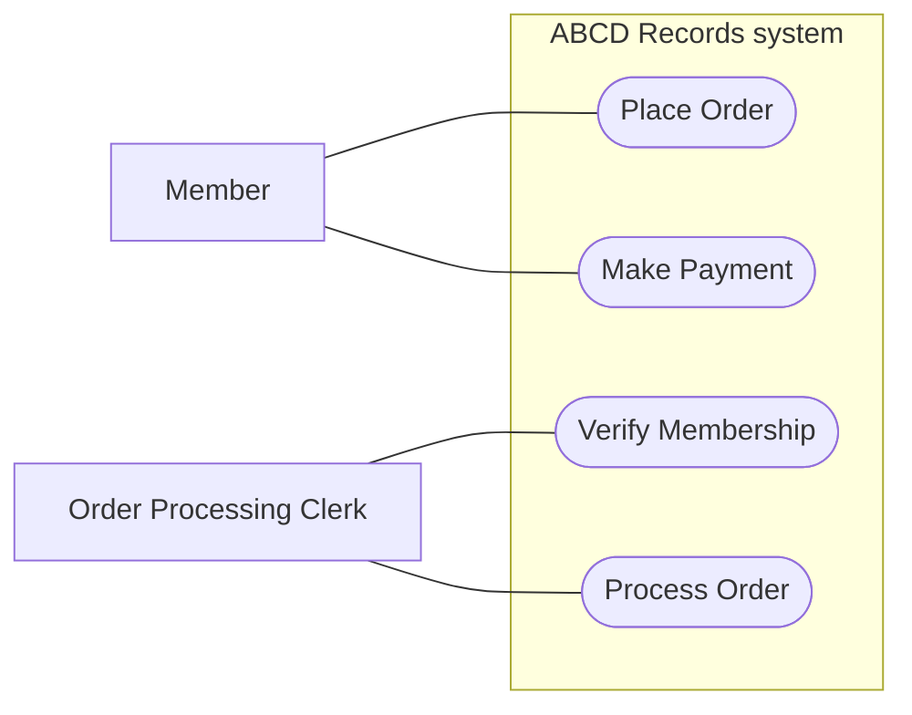
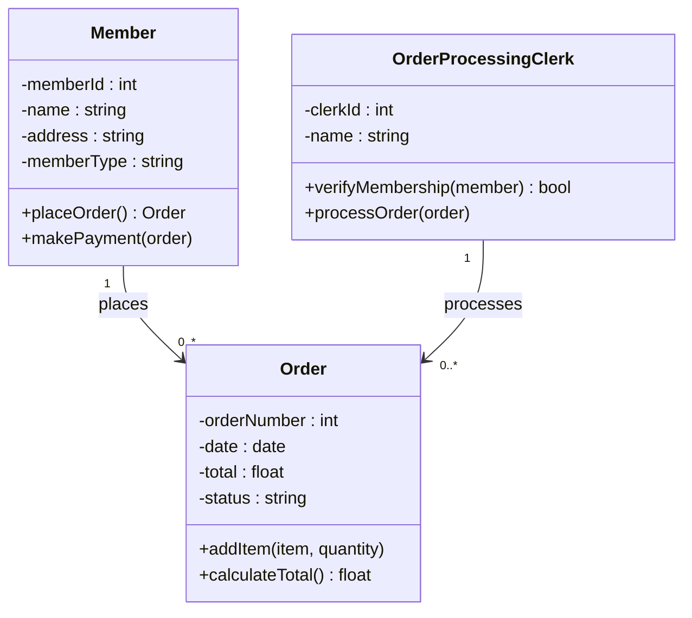
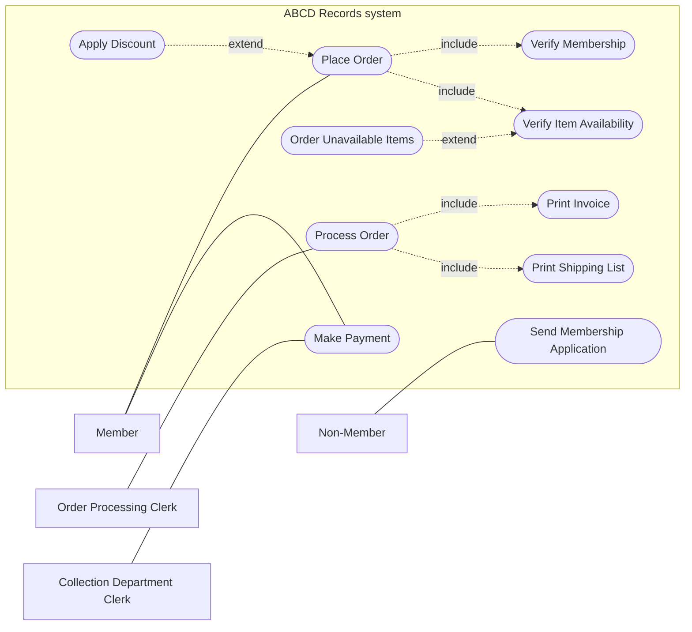
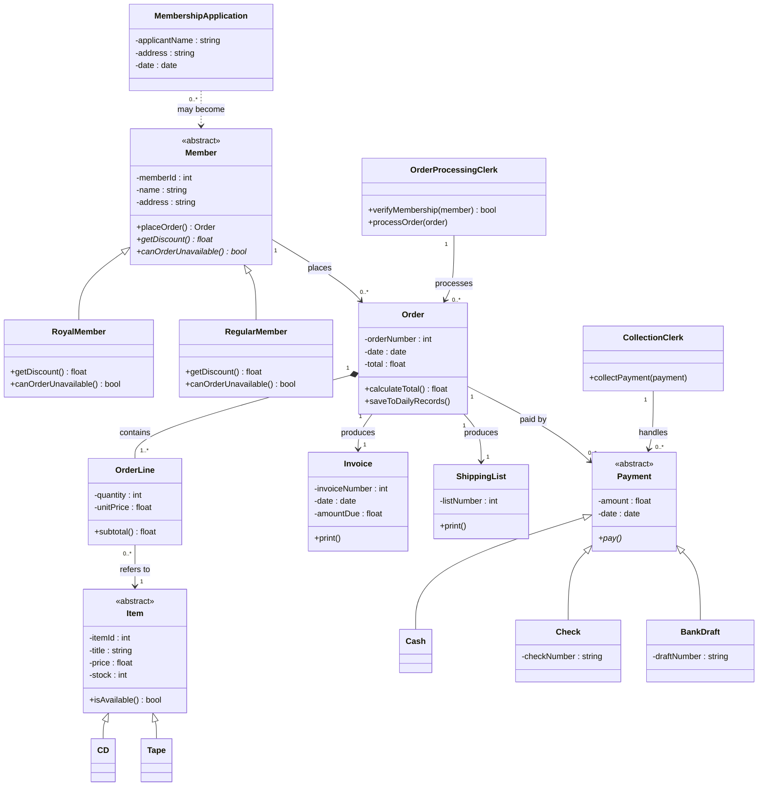
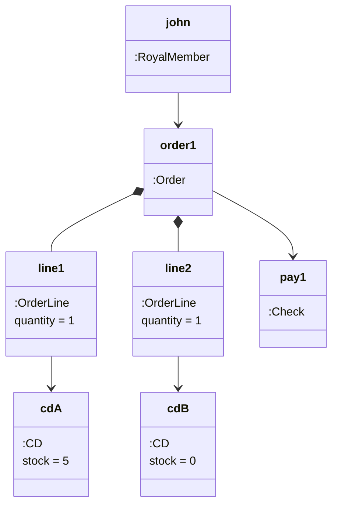
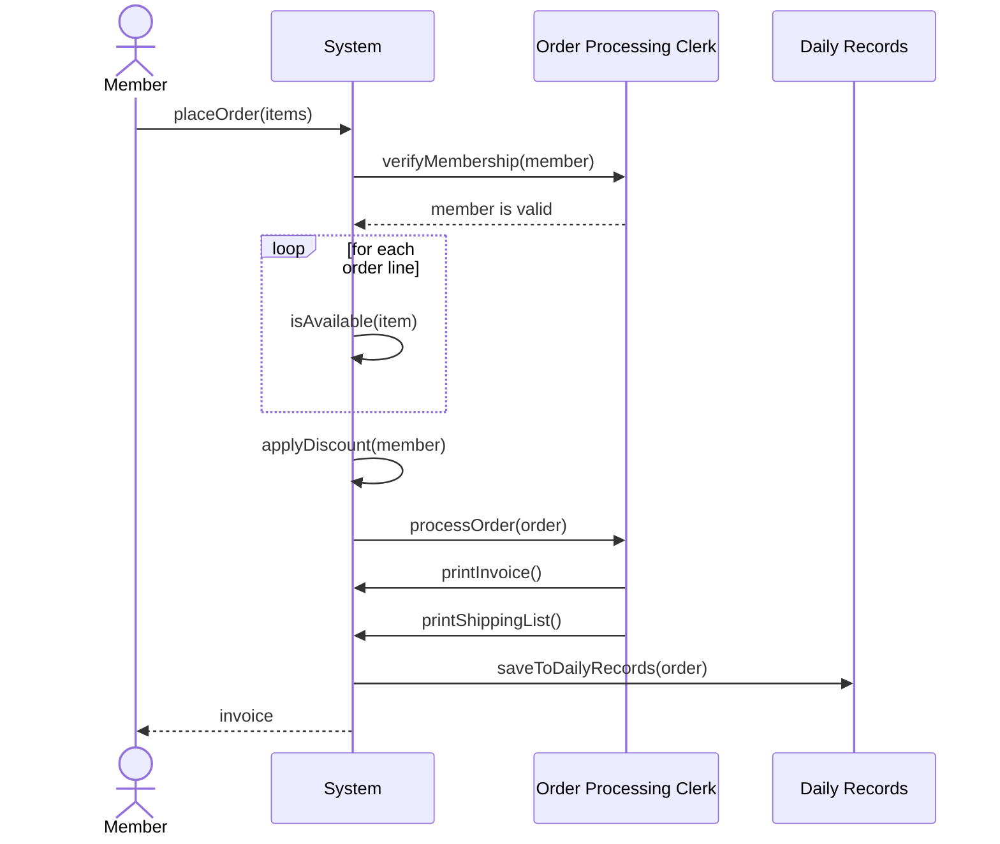
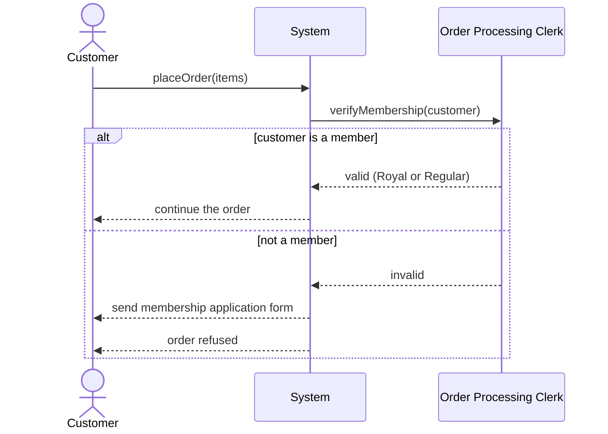
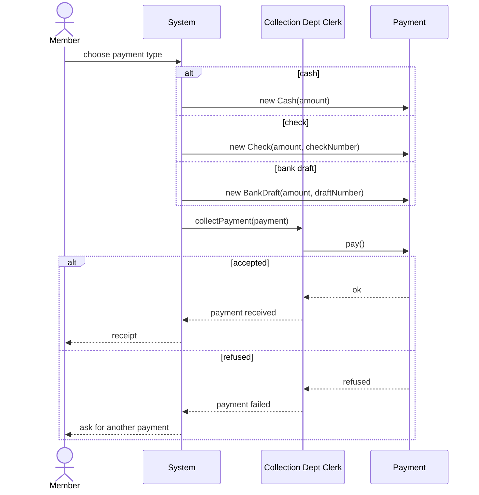
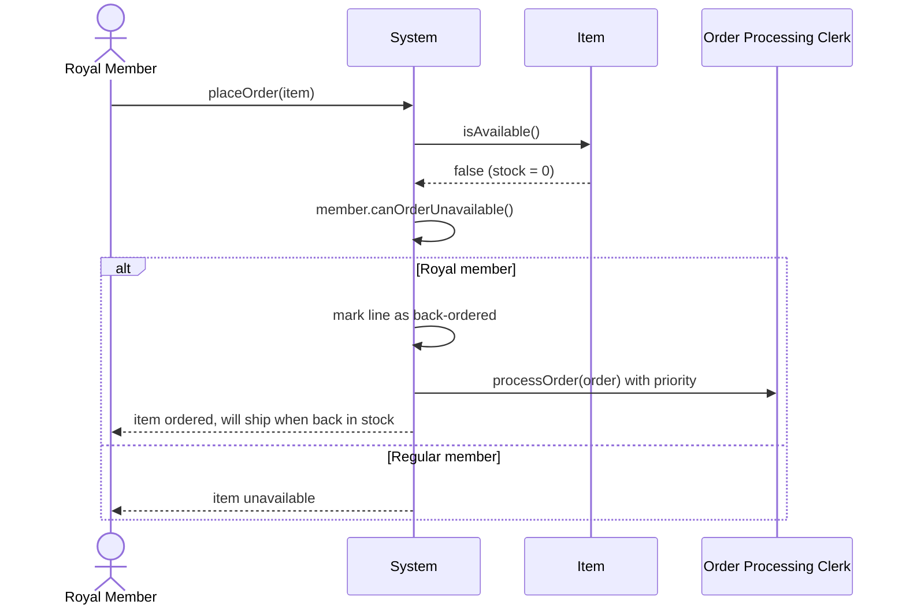

# uml exo 2: abcd records

ABCD Records is a mail-order company that sells CDs and tapes at discount prices to record club members.

Rules:
1. only members can place orders
2. non-members receive a membership application form
3. two kinds of members: **Royal** (discounts + priority) and **Regular**
4. Royal members can order items that are not available
5. payment by cash, check or bank draft
6. the order processing clerk verifies and processes the orders
7. the collection department clerk handles the payments
8. all orders are saved in a daily records file

## level 1

### task 1.1: use case diagram

Actors: Member, Order Processing Clerk. Use cases: Place Order, Verify Membership, Process Order, Make Payment.

### task 1.2: class diagram

## level 2

### task 2.1: complete use case diagram

New actors: Collection Department Clerk, Non-Member. New use cases: Verify Item Availability, Apply Discount, Print Invoice, Print Shipping List, Order Unavailable Items, Send Membership Application.

- **include** = "this step is always done" (mandatory). Place Order always includes Verify Membership and Verify Item Availability; Process Order always includes Print Invoice and Print Shipping List.
- **extend** = "this step happens only sometimes" (optional). Apply Discount extends Place Order (only for Royal members); Order Unavailable Items extends Verify Item Availability (only when an item is missing, and only for Royal members).

When a non-member tries to order, Verify Membership fails and the system sends a membership application (Send Membership Application).

### task 2.2: complete class diagram

Inheritance is used for the 3 families: **Member** (Royal / Regular), **Item** (CD / Tape) and **Payment** (Cash / Check / BankDraft).

Multiplicities: an order has at least one line (`1..*`) and the lines belong only to that order (composition, filled diamond: if the order is deleted, its lines go too). An item can appear in many order lines, and a line refers to exactly one item (aggregation-like link).

Scenario: a Royal member orders 2 CDs (one is unavailable) and pays by check.

Because john is a Royal member, he is allowed to order `cdB` even if stock = 0; a Regular member would be refused for that line.

## level 3: sequence diagrams

### complete order processing flow

### membership verification (success and failure)

### payment processing (all types)

### item reordering for royal members

