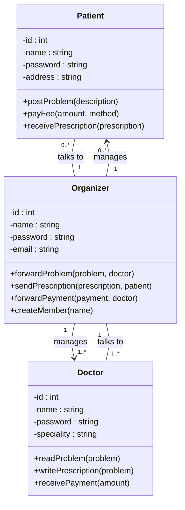
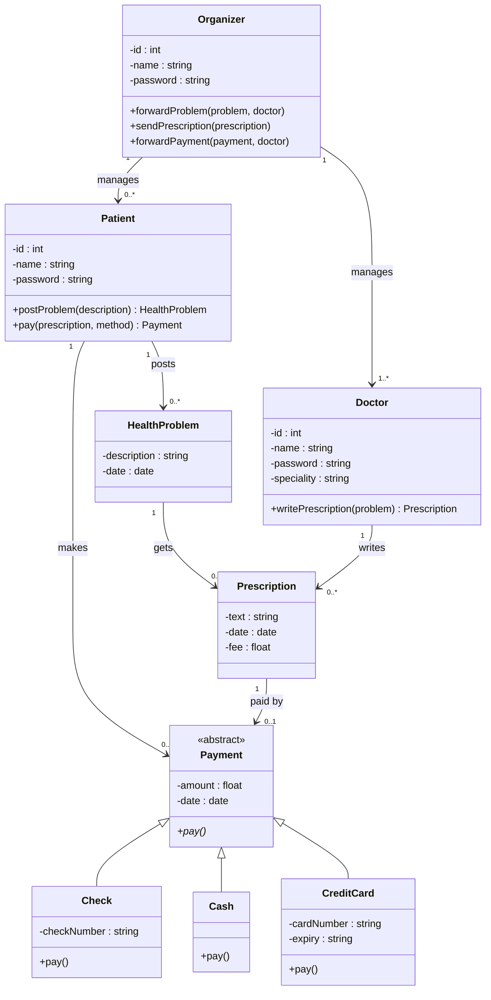
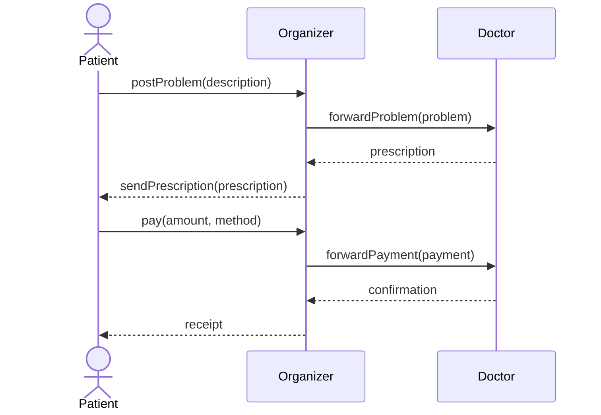
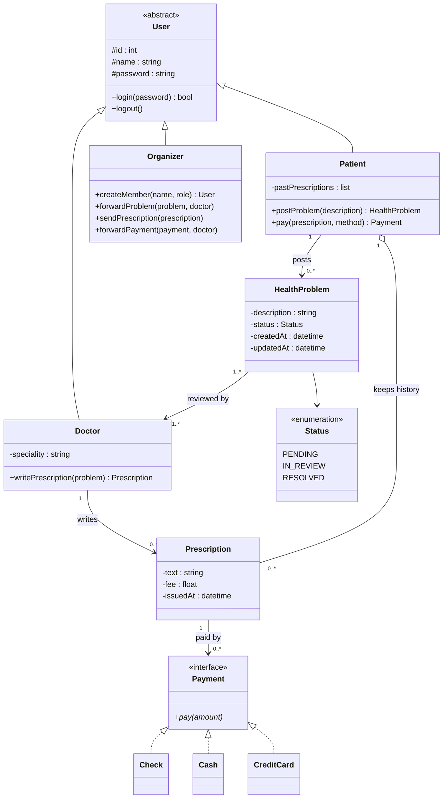
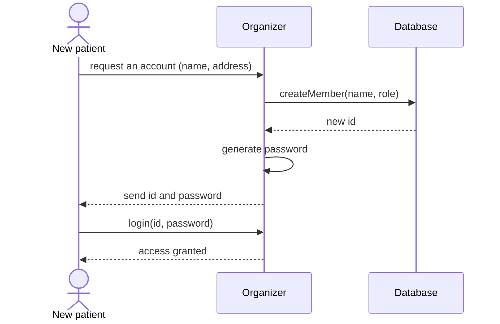
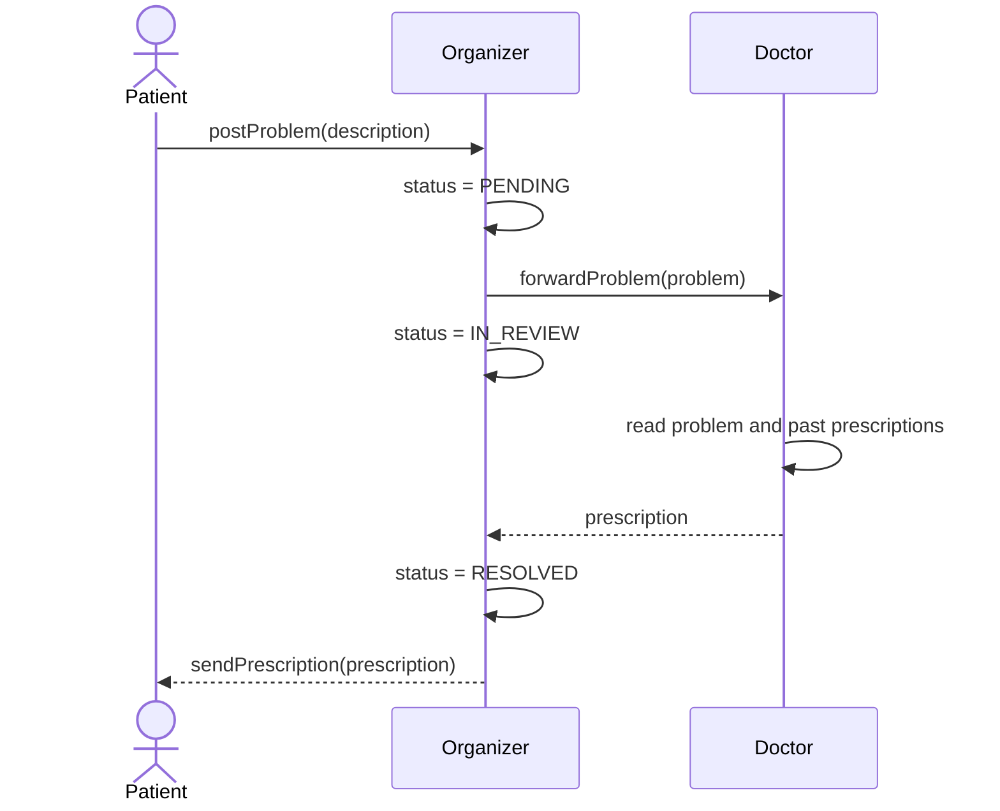
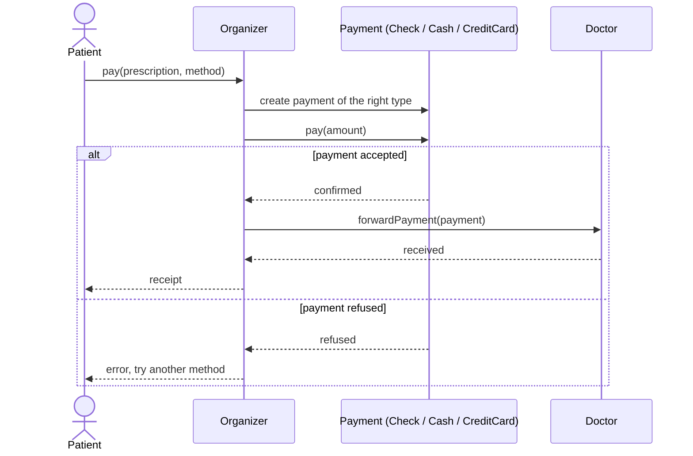

# uml exo 1: hospital management system

Patients post a health problem online, the organizer asks a doctor, the doctor gives a prescription, the organizer sends it to the patient, the patient pays (check, cash or credit card) and the organizer forwards the payment to the doctor. The organizer is also the administrator (database, member ids and passwords).

## task 1: basic architecture (class diagram)

Who does what?
- the **patient** posts a problem, receives a prescription and pays
- the **doctor** reads the problem and writes the prescription
- the **organizer** is the middleman: forwards problems, sends prescriptions, collects and forwards the money, creates the accounts

Multiplicities: one organizer manages many patients (0 or more) and at least one doctor. A patient and a doctor never talk directly, they only talk to the organizer.

## task 2: develop the system

New classes: `HealthProblem`, `Prescription`, `Payment`. Payment types (`Check`, `Cash`, `CreditCard`) are **subclasses** of `Payment` (inheritance), because each one has its own details (check number, card number...) but they all share the amount and the date.

Sequence diagram: a patient submits a problem, receives a prescription and pays.

## task 3: advanced

Changes:
- a **`User`** superclass holds what the three roles share (`id`, `name`, `password`, `login()`, `logout()`); `Patient`, `Doctor` and `Organizer` inherit from it
- payment uses **polymorphism** (strategy): `Payment` is an interface, the organizer calls `pay()` without knowing which type it is
- `HealthProblem` has a **status** (pending, in-review, resolved) and timestamps
- a patient keeps the list of **past prescriptions**

### sequence 1: patient registration (the organizer creates a new member)

### sequence 2: consultation flow (problem to prescription)

### sequence 3: payment processing

## questions to consider

1. **A patient consulting several doctors?** `HealthProblem` to `Doctor` becomes many-to-many (`1..*` on both sides). Each doctor writes his own prescription for the same problem.
2. **Reusable prescriptions?** Keep prescriptions in the patient's history (aggregation: a prescription still exists on its own). A repeat prescription is a new `Prescription` that points to the old one (`renewalOf`), so the original is never changed.
3. **Which design pattern for payments?** **Strategy** (each payment method is a strategy with the same `pay()` method) with a **Factory** to create the right one from "check", "cash" or "credit_card".
4. **Data integrity when paying?** Check the data before charging, never mark a prescription as paid until the payment is confirmed, do "charge + record + forward to doctor" as one transaction (all or nothing), and keep each payment with a unique id so it can't be counted twice.
